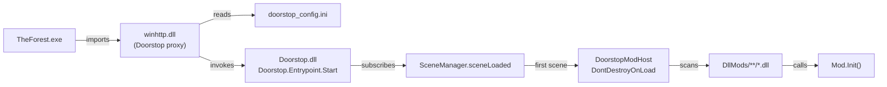

# The Forest Mod Loader

[](https://github.com/devypluggy/modkit/releases)
[](LICENSE)
[-9be564)](#requirements)

**Download:** [latest release](https://github.com/devypluggy/modkit/releases/latest) — one `ForestModLoader.exe`, no install, works offline.

A lightweight, non-invasive **mod loader for The Forest** (Unity 5.6, Mono, x64), built on top of [UnityDoorstop](https://github.com/NeighTools/UnityDoorstop).

No game files are patched. Drop your `.dll` into `DllMods/` — it loads automatically on startup.

```
Game root
├── winhttp.dll              ← Doorstop proxy (loads our loader)
├── doorstop_config.ini      ← points to Doorstop.dll
├── Doorstop.dll             ← the loader
└── DllMods/
    └── YourMod.dll          ← your mods
```

---

## Features

- **Zero patching** — original game files stay untouched; uninstall is just deleting three files.
- **Auto-discovery** — every `DllMods/**/*.dll` is loaded and its `public static void Init()` is called.
- **Survives Steam "Verify integrity"** — nothing in `TheForest_Data` is modified.
- **No .NET SDK required** — builds with the C# 3.0 compiler from .NET 3.5, bundled with Windows.
- **Plain .NET 3.5 assemblies** — same runtime as the game, full access to `Assembly-CSharp`, `UnityEngine`, `TheForest.*`.
- **File log** — everything is written to `doorstop_loader.log` next to the executable.

---

## How it works



1. Windows resolves `winhttp.dll` from the game folder instead of `System32`.
2. Doorstop reads `doorstop_config.ini` and calls `Doorstop.Entrypoint.Start()` inside the game's Mono runtime.
3. The loader subscribes to `SceneManager.sceneLoaded` (with an `AssemblyLoad` fallback) and waits for the engine to finish initializing.
4. On the first loaded scene it creates a persistent `DoorstopModHost`.
5. On the first `Update()` the host scans `DllMods/`, loads each assembly and invokes every `public static void Init()` with no parameters.
6. All steps are logged to `doorstop_loader.log`.

---

## Requirements

| | |
|---|---|
| Game | The Forest (Steam, **64-bit** `TheForest.exe`) |
| Runtime | Unity 5.6 Mono — .NET 2.0/3.5 |
| OS | Windows 10/11 x64 |
| Build tools | `C:\Windows\Microsoft.NET\Framework64\v3.5\csc.exe` (ships with Windows) |

The 32-bit `TheForest32.exe` is **not** supported (Doorstop `winhttp.dll` here is x64).

---

## Installation

### One-click launcher

Download **`ForestModLoader.exe`** and run it. It auto-detects the game folder
(Steam registry → `libraryfolders.vdf`), installs the loader and can start the game.

- `Установить` / *Install* — copies the loader into the game folder
- `Запустить игру` / *Play* — starts `TheForest.exe` normally (no admin rights)
- `Удалить` / *Uninstall* — removes the loader and `DllMods/`

The executable is **unsigned**, so SmartScreen may warn: *More info → Run anyway*.
If the game is in `Program Files`, Windows asks for elevation once; the game itself
is still launched without admin rights.

### From a release

1. Download and extract the release archive.
2. Copy into your game folder (the one containing `TheForest.exe`):

```
winhttp.dll
doorstop_config.ini
Doorstop.dll
DllMods\SampleCheats.dll     (optional)
```

3. Launch the game **normally through Steam**.
4. After reaching the main menu, check `doorstop_loader.log` in the game folder.

> The default install path is
> `C:\Program Files (x86)\Steam\steamapps\common\The Forest`.

### From source

```powershell
# build Doorstop.dll + SampleCheats.dll into .\out
powershell -ExecutionPolicy Bypass -File .\build.ps1

# build and copy everything into the game folder
powershell -ExecutionPolicy Bypass -File .\build.ps1 -Install `
    -GameDir "C:\Program Files (x86)\Steam\steamapps\common\The Forest"
```

`build.ps1` uses the Windows-bundled C# 3.5 compiler and references the game assemblies from
`..\Managed` (`Assembly-CSharp.dll`, `UnityEngine.dll`, `TheForest.Modding.dll`).

Building the launcher (embeds the four loader files as resources):

```powershell
powershell -ExecutionPolicy Bypass -File .\launcher\build-launcher.ps1
# → out\ForestModLoader.exe
```

---

## Writing a mod

A mod is a class library targeting **.NET 3.5 / C# 3.0** with one public static entry point:

```csharp
using UnityEngine;

public static class MyMod
{
    public static void Init()
    {
        GameObject go = new GameObject("MyMod");
        Object.DontDestroyOnLoad(go);
        go.AddComponent<MyBehaviour>();
    }
}

public class MyBehaviour : MonoBehaviour
{
    private void Update()
    {
        if (Input.GetKeyDown(KeyCode.F7))
        {
            // your code here
        }
    }
}
```

Compile it against the game assemblies:

```bat
set CSC=C:\Windows\Microsoft.NET\Framework64\v3.5\csc.exe
set MANAGED=<game>\TheForest_Data\Managed

"%CSC%" /nologo /noconfig /target:library /out:MyMod.dll ^
    /r:"%WINDIR%\Microsoft.NET\Framework64\v2.0.50727\System.dll" ^
    /r:"%MANAGED%\UnityEngine.dll" ^
    /r:"%MANAGED%\Assembly-CSharp.dll" ^
    /r:"%MANAGED%\TheForest.Modding.dll" ^
    MyMod.cs
```

Then drop `MyMod.dll` into `DllMods\`.

### Notes for mod authors

- `Init()` is called **after** the first scene loads, but `LocalPlayer` may still be `null`
  (e.g. in the title menu). Put gameplay logic in `Update()` and null-check.
- Use `DontDestroyOnLoad` on your host object, otherwise it dies on scene change.
- C# 3.0 only: no string interpolation, no `?.`, no `async`, no `nameof`.
- The full game API is available — start from the decompiled `Assembly-CSharp`
  (`TheForest.DebugConsole`, `Cheats`, `PlayerStats`, `LocalPlayer`, `Inventory`, ...).

### Sample mod

`src/SampleCheats.cs` demonstrates the pattern:

| Key | Action |
|---|---|
| `F8` | Restore health / energy / stamina / fullness, reset thirst |
| `F9` | Toggle `Cheats.GodMode` |
| `F10` | Toggle fly (WASD + Space/Ctrl, 20 m/s) |

---

## Project structure

```
.
├── src/
│   ├── Doorstop.cs          # the loader (entry point + ModHost)
│   └── SampleCheats.cs      # example mod
├── launcher/
│   ├── Launcher.cs          # WinForms installer / launcher
│   ├── app.manifest
│   └── build-launcher.ps1
├── assets/
│   ├── steam_logo_512.png   # Steam guide logo
│   └── icon.ico             # launcher icon
├── steam/
│   └── guide_ru.txt         # ready-to-paste Steam guide (BBCode)
├── doorstop/
│   ├── winhttp.dll          # UnityDoorstop 4.6.0 (x64, LGPL-2.1)
│   ├── doorstop_config.ini
│   └── LICENSE              # Doorstop license
├── out/                     # build output (git-ignored)
├── build.ps1
├── uninstall.ps1
└── README.md
```

---

## Configuration

`doorstop_config.ini` — only the fields below matter:

| Key | Value | Meaning |
|---|---|---|
| `[General] enabled` | `true` | Master switch |
| `target_assembly` | `Doorstop.dll` | Assembly whose `Doorstop.Entrypoint.Start()` is called |
| `redirect_output_log` | `false` | Keep Unity's own log in `%USERPROFILE%\AppData\LocalLow\SKS\The Forest\` |

Everything else can stay at defaults.

---

## Logs

`<game folder>\doorstop_loader.log` — append-only, written by the loader and by sample mods:

```
[19:20:47] Doorstop.Start, cwd=...\The Forest
[19:20:47] subscribed to SceneManager.sceneLoaded
[19:21:33] scene loaded: 'SteamDedicatedBootstrapScene' mode=2
[19:21:33] ModHost created
[19:21:37] LoadMods: ...\DllMods exists=True
[19:21:37] found mods: 1
[19:21:37] loaded assembly: SampleCheats
[19:21:37] Init called: SampleCheats
```

---

## Troubleshooting

| Symptom | Cause / fix |
|---|---|
| No `doorstop_loader.log` at all | `winhttp.dll` missing, wrong architecture (x86 build on x64 game), game not launched from the game folder, or antivirus blocked it |
| `doorstop_loader.log` exists, no `Init called` | Mod DLL missing in `DllMods/`, `Init` is not `public static` / has parameters, or assembly load failed — see the `mod load error` line |
| `Init called`, but nothing happens in game | Logic runs before `LocalPlayer` exists — move it to `Update()` and null-check |
| Game doesn't start after install | Delete `winhttp.dll` (and `doorstop_config.ini`) to roll back |
| Antivirus flags `winhttp.dll` | It's the unmodified UnityDoorstop proxy; add the game folder to exclusions or build Doorstop yourself |

Game log: `%USERPROFILE%\AppData\LocalLow\SKS\The Forest\output_log.txt`.

---

## Uninstall

```powershell
powershell -ExecutionPolicy Bypass -File .\uninstall.ps1
```

Removes `winhttp.dll`, `doorstop_config.ini`, `Doorstop.dll`, `doorstop_loader.log` and `DllMods/`.
Game files are untouched.

---

## Compatibility

- Tested with **The Forest** (Steam, Unity 5.6.5, x64).
- Coexists with nothing that patches `Assembly-CSharp.dll` — if you also use ModAPI,
  launch the game directly through Steam so the two loaders don't fight.
- Steam updates may overwrite `winhttp.dll`; just copy it back afterwards.

---

## Legal & credits

- **UnityDoorstop** © NeighTools — licensed under **LGPL-2.1**.
  The bundled `winhttp.dll` is an unmodified release binary (v4.6.0);
  source: <https://github.com/NeighTools/UnityDoorstop>.
- **The Forest** © Endnight Games. This project contains **no game code or assets**.
  You must own the game to use it. Do not redistribute `Assembly-CSharp.dll` or decompiled sources.
- This loader (`Doorstop.cs`, `SampleCheats.cs`, build scripts) is released under the **MIT License** — see `LICENSE`.
